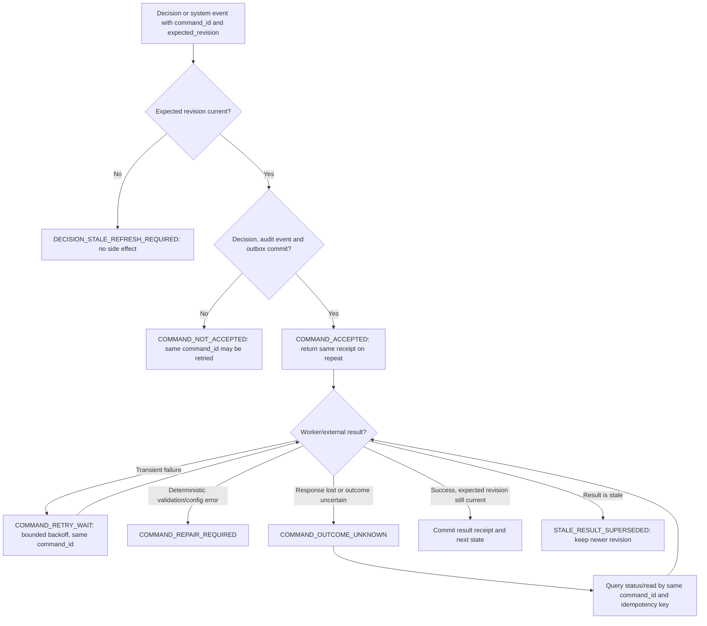
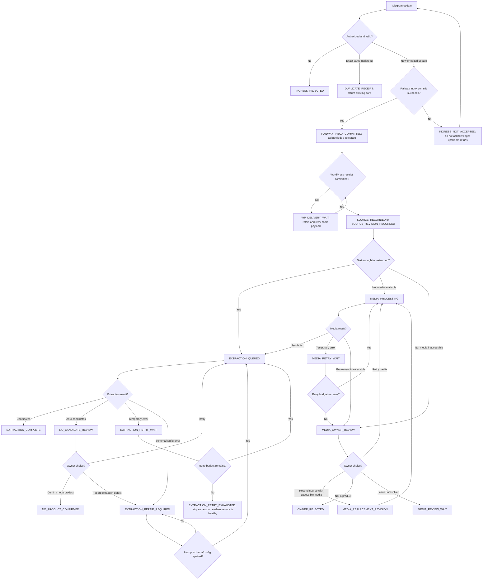
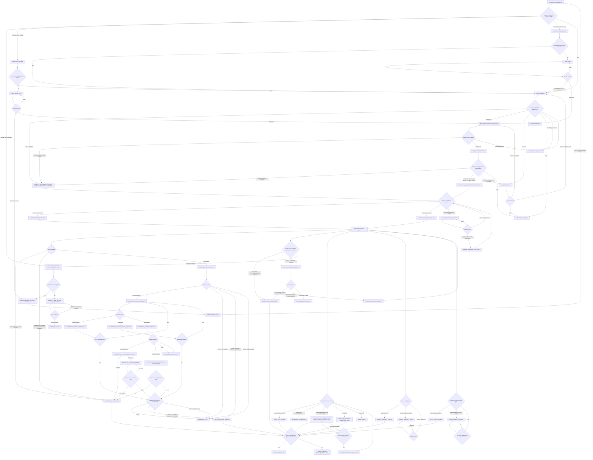
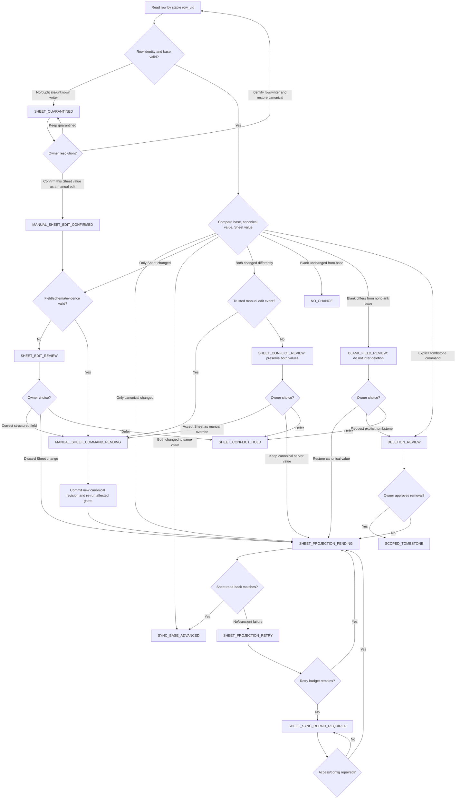
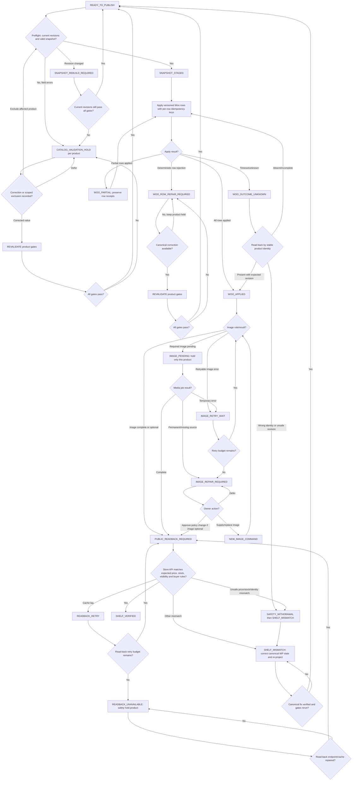
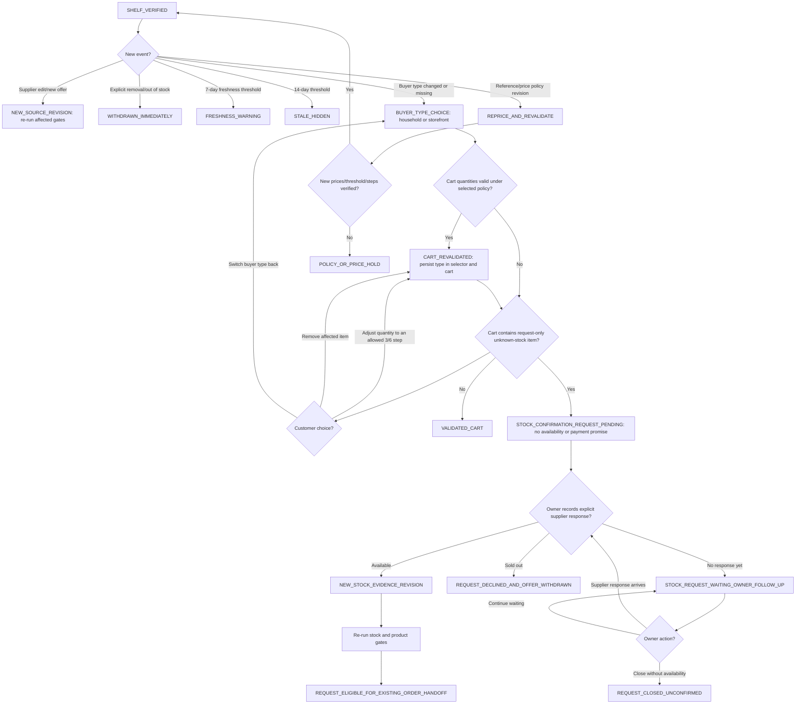

# Bot-to-shelf scenario and recovery architecture

**Status:** scenario architecture with durable queue visibility (`e31a2a5`), no-product
recovery (`7e48c28`), failed-batch reconciliation (`c0f474e`), and image/OCR recovery
(`870aea7`) implemented. Remaining gaps below are planned reformations, not claims of
current incidents. **Updated:** 2026-11-05 (Asia/Tehran).

## What runs today

The active path is:

```text
Telegram webhook
  → Railway SQLite inbox receipt (committed before webhook acknowledgement)
  → Railway pipeline worker
  → Google Sheets MessageData / Offers / Products
  → supplier freshness + reference + source-integrity gates
  → complete catalog snapshot to WordPress/WooCommerce
  → product/image receipt and public-store reconciliation
```

The WordPress dashboard reads several Railway workflow APIs and stores bounded review
context and audit events in a WordPress table. Railway SQLite and Google Sheets still
hold operational workflow state; the WordPress review table is not yet the authority for
those decisions. WooCommerce is the public shelf. A manual Sheet edit is an input that
must be recognized and applied under the agreed conflict rule.

The baseline production check on 2026-11-05 found both Railway services online, no pending
deployments or recent failures, and the main service's `pipeline-worker` and `web`
processes entered `RUNNING`. The public `/health` route reports the web app version; it
does not report worker heartbeat or prove that a queue item was processed. The owner
dashboard combines eight independent reads, retains previous successful responses when
a later read fails, and reports the failed source separately. Before this recovery
slice, its queue API capped the item list at 200.

Existing safeguards worth keeping include commit-before-ack intake, duplicate receipt
keys, leased jobs, source-linked offer integrity checks, revision-bound price
verification, stale-reference decisions, server-first one-sided Sheet reconciliation,
and complete-catalog reconciliation before declaring a publication successful.

## Deadlock and silent-loss risks found in the current implementation

1. **A batch hold can stop unrelated work.** `guarded_publish_shop` refuses every
   catalog publish while any publication hold exists. AI confirmation also rejects
   decisions while any hold exists. One bad batch can therefore block unrelated
   product decisions and the entire shelf. A hold is currently broader than its source
   batch/product scope.
2. **Some terminal generic batch failures are not included in the dashboard's repair
   action.** Most failures that create a hold are safely parked as `needs_review` on the
   next worker claim and can be reviewed. But a batch that reaches `failed` without a
   hold (for example, a queue-database failure before the hold is written) is omitted
   from the targeted backlog reconciliation: that action lists failed batches only
   when their error is exactly `JobConflict`. The operations list can show the generic
   failed row, but has no per-job retry/reconcile control.
   Implemented in Railway commit `c0f474e` and WordPress commit `899e166`: all failed
   batch receipts are listed; the owner can reconcile the bulk set or one exact receipt
   from its queue row. A receipt closes only after every expected source row has a
   reconciled terminal AI state and the full current Sheet-to-Woo sync succeeds.
   Incomplete sources stay failed and visible, and the original error is retained in
   the reconciliation receipt.
3. **Image-backed sources need a recovery decision even when text extraction finds no
   product.** A photo-only source now receives `needs_media_review`; an image post whose
   caption extraction returns no candidates joins the same media queue rather than
   appearing twice. Its owner card shows the photo, source link, and caption, with an
   explicit not-a-product decision or a bounded OCR retry. OCR transcribes visible text
   only, combines it with the saved caption, stores the transcript separately from the
   original source, and forces every extracted offer into owner review. Unavailable,
   unreadable, unsupported, and no-product outcomes remain visible for manual review.
   `needs_media_review` counts as source capture completion for batch reconciliation;
   it does not approve a product or authorize publication.
4. **A successful “no products” result is indistinguishable from an owner rejection.**
   `not_product` is used both when extraction produced no offer and when every offer
   was explicitly rejected. These outcomes need distinct states and different replay
   rules. Implemented in live commit `7e48c28`: zero-result and model-generated
   `not_product` outputs without an owner decision use `no_product_candidate`; only a
   durable owner decision uses `owner_rejected`. Re-extraction includes candidate and
   legacy undecided rows, while preserving explicit rejections. Empty results stay
   retryable after a run, and batch reconciliation accepts the new terminal statuses.
   Image-only posts still need the separate media/OCR review path.
5. **Reference activation is a multi-store operation without a resumable receipt.**
   The active snapshot can be switched before the Sheet projection and product
   re-evaluation finish. A later failure can return an error even though the active
   version changed; retrying with the prior version then conflicts. The dashboard needs
   a “resume remaining activation steps” action tied to one activation ID.
6. **The browser cannot always distinguish “failed” from “server acted, reply was
   lost.”** Some actions write a pending WordPress audit event, then call Railway. A
   connection loss can leave the pending event without a read-by-command-ID status
   check. Repeating a new request can create duplicate audit entries or turn a
   successful action into a misleading conflict.
7. **A worker outage can look healthy.** `/health` checks only the Flask process. The
   dashboard has job counts but no last-worker heartbeat, last claim/completion, or
   oldest queue age. Railway can report the service online while no processing progress
   is being made.
8. **Retries do not explain all failure classes.** Jobs retry exceptions uniformly and
   save the exception class, not a stable stage/error code and recovery instruction.
   After the retry limit, generic failed jobs are parked. The operations list is
   metadata-only and capped at 200, with no cursor-driven recovery queue.
9. **A long-running job can outlive its fixed lease.** A claim expires after 15 minutes
   and there is no lease heartbeat/extension. A second web/worker claimant can take an
   expired job while the first is still processing. The file lock and idempotent writes
   reduce duplicate effects, but the first claimant can lose its completion receipt.
10. **Catalog application can be partially visible.** WordPress validates the full
   payload first, then applies rows one at a time. If a later row or hide fails, earlier
   Woo changes may already be live. Re-sending the snapshot is usually idempotent, but
   the dashboard needs the exact snapshot and per-row receipt to prove what remains.
11. **Image delivery is a separate, partly opaque handoff.** A catalog may be accepted
    while images remain. A missing/expired Telegram file, an upload failure, or a lost
    image response needs its own durable media status; it must not be mistaken for a
    complete product handoff or force the product extraction to restart.

These are code-path findings, not a claim that each condition is currently active in
production. Railway's current green status is a point-in-time infrastructure check.

## Target ownership and data path

Make **WordPress the persistent business authority**, consistent with the owner's
direction. Keep **Railway as a small durable ingress/processing relay**, not a second
product or decision master. Google Sheets remains a controlled manual-edit/import
surface during transition; WooCommerce product records are the customer-facing
projection of WordPress decisions.

```text
Telegram
  → Railway ingress: authenticate, persist minimal inbox receipt + source payload, then ack
  → WordPress import endpoint: persist source revision + command atomically (idempotent)
  → WordPress source/product/decision tables + transactional outbox
  → Railway worker polls and leases outbox work over a scoped HTTPS API
  → Gemini extraction / normalization / reference matching
  → WordPress offer and product revisions; append an audit event
  → WordPress catalog outbox → versioned WooCommerce projection
  → Woo receipt + Store API read-back → verified shelf state

Google Sheets edit
  → compare Sheet value, last-synced base, and WordPress current revision
  → one-sided manual Sheet edit becomes a validated WordPress command
  → simultaneous divergence becomes a field-scoped review card
```

The ingress relay keeps only the durable delivery receipt and the minimum payload needed
to forward it; it does not own product, offer, reference, or decision state. It removes
the payload only after WordPress returns a durable receipt for the same source revision.
That small buffer protects accepted Telegram updates through a WordPress outage while
keeping the long-lived business data in WordPress. If Railway ingress itself is
unavailable, Telegram retries only within Telegram's delivery window; no design can
promise recovery from an outage longer than the upstream retention window without an
independent source-channel backfill. Add an alert on Telegram `pending_update_count` and
an operator catch-up procedure before calling intake loss-proof.

The worker polls the WordPress outbox, so processing does not depend on cPanel cron or
WP-Cron. Railway claims work with a renewable lease and heartbeat, performs slow
AI/network steps, and reports results using the same command ID. If Railway processing
is offline, WordPress retains the work and the dashboard shows the stalled queue. If
WordPress is offline, the ingress relay retains accepted items and retries delivery.

### Records and identities

- `source_message`: Telegram update ID + chat/message ID + edit timestamp + content
  hash; retain sender ID, visible forward-origin metadata, source URL, timestamp basis,
  text and media reference. Exact webhook repeats return the existing receipt. A
  supplier edit is a new immutable revision. Hash similarity alone never deduplicates
  two separately sent posts, since they may be separate offers.
- `extraction_run`: source revision, model/prompt version, result schema version,
  extracted candidates, per-field source evidence, validation errors and completion
  receipt. A rerun creates a new run; it never erases the prior result.
- `offer_revision`: one supplier/product candidate with stable Product ID, Offer ID,
  supplier/source identity, variant dimensions, price role, quantity basis, stock
  evidence, confidence, source revision and review status.
- `product`: current canonical identity and current accepted offer pointer. Product
  identity includes supplier, normalized base name, brand, variant, size/weight and
  package count. An ambiguous or conflicting dimension never auto-merges.
- `owner_decision`: actor, target revision, structured choice, timestamp, note when
  required, and resulting command ID. A correction supersedes a prior decision; it
  does not rewrite history.
- `outbox_command`: stable ID, kind, target IDs/revisions, expected revision, state,
  attempt schedule, lease, last safe error code, result receipt and next action.
- `catalog_snapshot`: monotonically increasing snapshot ID/digest, expected products,
  per-product apply receipts, image receipts, and final Store API verification.
- `sheet_sync_base`: last synchronized value/revision per editable field, used for
  three-way conflict detection without trusting unavailable per-cell editor identity.

Raw message text and business decisions belong in WordPress. Store image bytes in the
WordPress media system or its configured object storage and keep only the media key in
the business row. Avoid retaining full payloads in Railway after WordPress confirms
receipt; the worker fetches bounded source data for the duration of processing. The
ingress buffer is the exception and has a deletion receipt/retention limit.

## State model: every non-terminal state has an owner and next action

Keep state per entity instead of using one overloaded “queue status.”

| Entity | Normal path | Parked/terminal states |
|---|---|---|
| Source message | `received → extracting → extracted` | `needs_media_review`, `needs_owner_review`, `no_product_candidate`, `owner_rejected`, `retry_wait`, `failed_action`, `superseded` |
| Offer revision | `candidate → matched → approved` | `match_required`, `price_basis_required`, `source_price_missing`, `stock_unknown`, `held`, `rejected`, `superseded` |
| Product | `draft → ready → publishing → shelf_verified` | `request_only_unknown_stock`, `held_source`, `held_price`, `held_stock` (explicit sold-out/owner hold), `held_reference`, `held_conflict`, `source_integrity_error`, `publish_retry`, `shelf_mismatch`, `withdrawn` |
| Command | `ready → leased → succeeded` | `waiting_dependency`, `retry_wait`, `outcome_unknown`, `needs_owner`, `failed_action`, `cancelled`, `superseded` |
| Reference refresh | `requested → fetching → candidate_staged → owner_review → active` | `refresh_retry`, `refresh_failed`, `awaiting_stale-use-choice`, `activation_partial`, `superseded` |

For every open task the dashboard must be able to render:

`what happened · what is affected · source link · current revision · why it stopped ·
what is safe to do next · one primary action · expected result · retry/status link`.

An action that depends on an owner choice is not auto-retried. A transient network or
rate-limit error is retried with bounded exponential backoff and jitter. A deterministic
validation/configuration error is parked immediately with a repair instruction. A stale
revision refreshes the card and requires a new choice. An unknown response is resolved
by looking up the original command ID; it is never converted into a second command.

## Scenario-to-recovery map

| Scenario | Safe system behavior | Dashboard path |
|---|---|---|
| Telegram sends the same update again or a request times out after persistence | Return the original receipt by idempotency key; do not create another message, offer or batch. | Show “already received” and link to the same source card. |
| Supplier edits a channel post | Create a new source revision using Telegram `edit_date`; retain prior revisions and offers. | New revision appears on the existing Product card with old/new source values. |
| Owner re-forwards an old supplier post | Preserve Telegram's original forward date when exposed. If origin/date is hidden, record the source date as unknown; do not refresh supplier price or stock age from the owner's forward time. | Show “old source” or “source date unknown” with an action to open the original post and verify current price. |
| Unauthorized private Telegram sender, group, malformed or unsupported update | Groups and unsupported updates create no work. For a private Telegram sender, persist only chat ID, first/last seen time, count and revision; never persist its message text. If that small identity receipt cannot commit, return 503 so Telegram retries instead of silently losing the enrollment request. | Owner sees the private sender in the operations dashboard and can allow or reject with one click. The revision-bound decision and receipt are written to the WordPress review database; the Railway ingress database keeps only the approved chat ID needed to enforce access at webhook time. |
| Railway cannot durably accept an update, or WordPress is temporarily unavailable after acceptance | If Railway cannot commit its inbox receipt, do not acknowledge; let Telegram retry and alert on pending updates. If the durable Railway receipt exists, acknowledge and retry the same payload to WordPress until WP returns its durable receipt. | Show ingress storage health, pending-update count, oldest buffered item, and WordPress delivery age. The catch-up procedure covers expiry of Telegram's retry window. |
| Text + image, album, image-only, unsupported media, or inaccessible media | Extract text when available; track media/OCR separately. Never mark image-only as `owner_rejected`. If OCR is unavailable, save `needs_media_review`. | One source card with preview, text/OCR state and actions to inspect, retry OCR, resend/attach accessible media, or explicitly mark not a product. |
| Gemini timeout, quota, malformed JSON or schema drift | Save the run/error code; retry only transient errors; preserve source and prior runs. No product projection. | “Retry extraction” for transient errors; “prompt/schema needs repair” with a run ID for deterministic errors. |
| Gemini returns zero candidates | Store `no_product_candidate`, distinct from owner rejection; auto-close only if the configured classifier has sufficient evidence. | Review card shows source excerpt and choices “not a product” / “extract again” / “report extraction error.” |
| Obvious price, consumer price, unit/package basis, package count or stock evidence is missing/ambiguous | Preserve detected amounts and their exact source lines. Never infer a supplier price from consumer price or treat price verification as stock verification. | Structured choices on the card; show unit/package math and evidence; no free typing for normal cases. |
| Multiple variants, unequal prices, missing flavor/size, extra/missing staged variants | Create separate stable product candidates; group only variants with identical source and commercial terms. Validate source variant coverage before bulk approval. | Show all source-listed variants beside staged variants; offer group confirm only when counts/terms match. |
| Reference has one compatible candidate / many candidates / none | One candidate can be suggested, never silently accepted when material attributes conflict. Store assignment against exact snapshot ID and price role. | Compare brand/category/variant/size/pack + unit/package prices; choose one candidate, no-match, or defer. |
| Reference snapshot is missing, older than 24 hours, refresh fails, or changes mid-review | Create an occurrence-bound event. Ask per D-009: pause, or explicitly continue with the last successful snapshot and warning. Never silently fall back. | “Refresh,” “pause this batch,” or “use last snapshot for this occurrence.” Activation and dependent re-evaluation resume from their durable step receipt. |
| Sheet append/read/write returns 429/5xx, timeout or uncertain response | Retry using stable Offer IDs; read back and verify one row per Offer ID before moving the product pointer. Keep the batch in a visible reconciliation state. | Show affected message/Offer IDs and counts; “check source rows,” then “resume missing writes” or “close as already written.” |
| Offer pointer is missing, duplicated, mismatched, or points to wrong provenance | Fail closed for that product. Never synthesize source evidence. Preserve the latest good shelf state only if current safety policy allows it; otherwise hide. | Product card shows precise broken link and source post; actions are “restore from verified source” or “keep held.” |
| Sheet-only manual edit | Compare Sheet to last-synced base and current WordPress revision; validate the field and accept as an explicit command into WP. | Show “manual Sheet edit detected” and the exact field/value; one action sends it into canonical WP state, then re-projects. |
| Canonical server and Sheet both changed same field | Keep both values and block that field/product; do not let later polling overwrite either. | Show base, current canonical value (Railway-computed before cutover, WordPress after), Sheet value and source revision. Default to the named canonical owner; accept Sheet only as a confirmed manual edit. |
| An old GAS/other writer changes Sheets outside the controlled bridge | Detect unexpected writer/revision drift and quarantine the field; do not assume it is the owner's intentional edit. | Show “unrecognized writer” with values and last known base; owner picks a value or disables the old writer after verification. |
| Supplier price ages past 7/14 days, supplier says out of stock, or stock is omitted | At 7 days warn; at 14 days hide/stop new requests under current policy. Explicit out-of-stock hides immediately. A recent unknown-stock offer remains request-only, never an availability claim. | Price verification and stock resolution are separate actions. A price check cannot clear an out-of-stock hold. |
| One product is held while other unrelated products are ready | Scope the hold to affected product revisions; keep unrelated decisions and safe catalog updates moving. | Card links to the specific blocker; global dashboard shows unaffected work continues. |
| Woo request fails before applying, after some rows, or after applying but before reply | Use `snapshot_id + product_id + revision` as idempotency key. Record per-row receipts; retry the same snapshot. Do not infer success from HTTP 200 alone. | Show `outcome_unknown` until read-back resolves it; then “retry remaining rows” or “mark verified.” |
| Woo rejects one malformed row or identity collision | Stage and validate the whole snapshot before activation; return exact product/source ID and field error. Do not delete absent products or leave an unexplained partial catalog. | Focused product card shows validation failure and safe correction path; other safe products can proceed. |
| Image upload is missing, expired or fails | Keep catalog and media receipts separate. Retry the media job; do not re-extract or duplicate product. Whether a missing image blocks purchase is an explicit catalog policy. | Product card says “catalog ready; image pending/failed” and has “retry image” with the source attachment. |
| Cache purge or Store API read-back disagrees with Woo write receipt | Do not mark shelf verified. Re-read by stable product ID/SKU and snapshot revision; purge and retry read-back. | Show “sent, not yet verified” until public visibility/purchasability matches. |
| Buyer switches household/storefront with a cart quantity that violates the new step, or cart loses buyer type | Revalidate the full cart against the selected buyer policy; preserve cart intent and never silently round quantity or alter price. | Show one concise cart-level suggestion for buyer switch; prompt only for products whose current quantity is invalid. Confirm buyer type in both store selector and cart, and verify resulting prices/threshold/step in Store API. |
| Double click, stale card, two operators or lost HTTP response | Every command has a stable ID and expected entity revision. Exact duplicate returns the prior receipt; stale decision returns current state. | Button locks while pending; after refresh, show “already completed,” “changed—review current version,” or “still processing.” |
| Railway worker stops, lease expires, SQLite/volume fills, or API remains up without progress | Worker heartbeat and lease age are first-class. Reclaim expired leases only with idempotent downstream keys. Alert on oldest queued age, volume pressure and repeated errors. | Persistent banner identifies worker vs API status and provides queue IDs; no “healthy” status based only on `/health`. |
| Queue exceeds one page or an endpoint is unavailable | Paginate with cursors; show each source's last successful read time. Disable decisions that rely on stale/missing data. | “Load more” and per-source status; never show a stale card as current without a stale badge. |

## Explicit decision tree: choice → resulting node → next step

Rectangles are durable workflow outcomes shown on the card; their records and receipts
live on the corresponding source, offer, product, command, or snapshot entity rather
than one giant status field. Diamonds are decision checks against evidence. Every branch
from a decision ends in a named durable outcome or terminal command receipt. `*_WAIT`,
`*_REVIEW`, and `*_HOLD` outcomes are recoverable and must name one next action. A
terminal outcome records why the source/offer ended. Transient Railway jobs are attempts
against these WordPress states, not separate business states. Price, reference, stock,
source-integrity, and buyer-policy gates can run independently after matching; a product
is ready only when every required gate for that product passes. This is the target graph;
these names are required states, not a claim that every node already exists in
production.

### Command wrapper applied to every decision



No click creates a second command just because the browser did not receive the first
reply. A stale decision reloads current evidence; the owner must decide against that
revision. A worker result from an old revision is retained for audit but cannot change
current product or shelf state.

### 1. Telegram intake, media, and extraction



### 2. Candidate, evidence, reference, and offer readiness



The join at `All required gates pass` is product-scoped. A hold on one offer does not
block unrelated products. `SOURCE_PRICE_MISSING`, explicit sold-out/owner stock holds,
and `REFERENCE_HOLD` cannot be cleared by confirming a different field. Unknown stock
is the separate `STOCK_UNKNOWN_REQUEST_ONLY` outcome while the supplier source is within
14 days; it stays visible for a customer request without claiming availability. That
request remains pending until an owner records explicit supplier availability; an
explicit sold-out response closes the request and withdraws the offer. No payment or
confirmed-order result is emitted from the request-only state.
While a reference candidate is staged or activation is partial, the previous active
snapshot remains the one used by live decisions. A staged candidate becomes active only
after the same activation ID completes; a rejected candidate leaves the prior snapshot
unchanged.

### 3. Sheet edits and cross-system reconciliation



After cutover, a valid one-sided manual Sheet edit becomes a WordPress command and
updates the canonical value. Before cutover, it updates the then-current authoritative
server. A Sheet **projection** failure after WordPress commits is its own retry node and
does not block Woo publication; an uncommitted Sheet-originated edit cannot affect the
product. The dashboard names the actual owner (`Railway` before that domain's cutover,
`WordPress` after), never the vague label “server.”

### 4. Publication, media, and shelf verification



`WOO_PARTIAL`, `WOO_OUTCOME_UNKNOWN`, and `IMAGE_PENDING` retain their own receipts; no
new extraction or duplicate product is created to recover them. Product removals are
not activated from an incomplete snapshot. A dangerous public price/stock mismatch
triggers an immediate product-scoped safety withdrawal before repair.

### 5. Live shelf updates and buyer/cart choices



The household threshold is recalculated from the current value of a 24-unit common tuna
case; the storefront threshold is 4× that value. The stored 3/6 purchase step must carry
an explicit unit basis. A buyer-type change shows one cart-level threshold suggestion;
it asks for action only on products whose current quantity is invalid and never silently
rounds the quantity. A cart containing unknown-stock items creates a WordPress
availability-request record. Only an explicit supplier response updates stock evidence;
no order confirmation, availability claim, or payment result comes from that request
state. After confirmation the existing order handoff decides the next stage.

## Decision-to-transition contract

Every choice below must be a durable command against a specific entity revision. The
command transaction writes the decision/event, advances the relevant revision, and
creates the next outbox job together. The UI shows the same command ID until it reaches
a receipt or an explicit owner-waiting state. It must never turn a click into an
untracked side effect.

| Decision point | Choices and required evidence | Persisted outcome | Required next workflow |
|---|---|---|---|
| Intake identity/access | Authorized message, exact duplicate, edited message, unauthorized sender, malformed update | Store an immutable source revision and receipt; deduplicate by bot/chat/message/edit identity; record safe rejection separately | Accepted source gets one extraction command. Duplicate opens the existing card. Rejection gets no product command. An edit supersedes prior active extraction while retaining history. |
| Media interpretation | Text sufficient, OCR/transcription needed, inaccessible media, explicitly not a product | Store each attachment key and OCR run separately; unresolved media is `needs_media_review`; explicit owner rejection is `owner_rejected` | Retry media processing without re-running completed extraction; then extract from combined text/evidence. No-product/reject closes only that revision, not later edits. |
| Extraction result | Valid candidates, zero candidates, incomplete/ambiguous fields, transient model error, schema/model error | Save immutable extraction run, prompt/model/schema versions, field evidence and stable error code | Transient error retries same run command safely. Zero candidates gets a “not product / retry / report” card. Missing material fields route to only those fields. Schema/config errors stop for repair and are not retried as if transient. |
| Product/reference match | Unique compatible candidate, several candidates, no match, defer, new product | Save candidate set and evidence; owner assignment pins reference ID + snapshot ID + unit/package price role; “new product” creates a new canonical ID only after duplicate check | Revalidate against the pinned snapshot and product revision. One clear candidate may be recommended but any material size/brand/variant conflict remains a choice. Defer leaves the item held and does not block unrelated products. |
| Variant grouping | Same commercial terms and complete variant coverage, unequal terms, missing source variant, duplicate variant | Save one offer per distinct price/stock term and the explicit variant set; retain source lines | Bulk approval is enabled only for a validated complete set. Unequal price or stock splits the group; missing/extra variants returns only those variants for review. |
| Price interpretation | Supplier sale price, regular/consumer price, price per unit, price per package, unclear amount, no supplier price | Store raw text, normalized amount/currency, exact source span, role and quantity basis; classify phone numbers, dates and pack counts separately from prices | A missing supplier sale price remains missing; retail price is never substituted. Persian/Arabic digits and separators are normalized with the original preserved. Ambiguous currency or amount role is held. Confirmed price changes enqueue Sheet/Woo projections. |
| Supplier price verification | Confirm the extracted amount against the exact current source revision, correct it from explicit evidence, request a current source, or defer | Append a price-verification event to that offer revision, or create a corrected offer revision with source span; never edit the old evidence in place | A confirmed supplier price can pass the price gate. A missing/unverifiable price stays held or the offer is rejected. Price verification never changes stock state. A new source update reopens verification for the new revision. |
| Buyer pricing and order rules | Current supplier/reference inputs and a published policy revision exist; household/storefront price, discount cap, threshold and quantity step are derived | Store policy version, input revisions, buyer type, price result, pack size, min/step quantity and threshold basis together | Apply the approved rule: storefront discount is higher and closer to supplier sale price; household threshold follows the current value of a 24-unit common tuna-can case and storefront threshold is 4×. Keep the configured 3/6 quantity step with an explicit unit basis. If the benchmark, input or policy is missing/stale, stop publication for the affected rule and show the exact repair; never guess or silently use a hard-coded threshold. |
| Stock/freshness | Explicit available, explicit out of stock, unknown, current price checked, stale evidence | Store stock evidence and price-verification evidence separately with source and observation time | Explicit out of stock withdraws/blocks that product immediately. Unknown stays request-only while the source is within 14 days; owner records an explicit supplier response before it can become available. At 7 days warn; at 14 days hide. Price verification alone cannot change stock state. |
| Supplier lifecycle/removal | Supplier explicitly says remove/discontinue/out of stock, post is merely old, or supplier publishes a newer current offer | Append a lifecycle event linked to the source revision; preserve prior offer and the reason/time it stopped being active | Explicit removal/out-of-stock takes the product off the shelf immediately. Age-based expiry follows the configured freshness policy. A newer post can create a new offer revision but cannot silently reverse an explicit takedown; reactivation must pass source, stock, price and reference checks. A forwarded old post keeps its original age. |
| Reference freshness | Fresh snapshot, missing/stale snapshot, refresh, pause, use last successful snapshot for this occurrence, reject staged snapshot, defer activation | Store immutable candidate snapshot, validation result, activation ID, owner choice and per-step receipts | Fresh snapshot proceeds. Stale/missing requires an explicit per-occurrence choice: refresh, pause, or use last successful with a warning if one exists. A valid refresh is staged for owner activation; rejection leaves the prior snapshot active. Partial activation resumes by the same ID; invalid data never replaces the prior snapshot. |
| Sheet synchronization | Sheet-only change, WordPress-only change, equal concurrent change, divergent changes, blank/delete, unknown row | Store stable `row_uid`, field, base hash/value, observed values and sync command; preserve both values on ambiguity | Sheet-only validated edit becomes a WP decision and then re-projects. WP-only update projects to Sheet. Equal values converge. Divergence is held unless trusted manual-edit provenance proves the Sheet choice. A changed blank is reviewed, never treated as deletion; deletion requires an explicit tombstone command. Unknown/duplicate rows are quarantined. |
| Owner correction/rejection | Correct a field, reject an offer, hold, supersede an offer, withdraw product | Append decision with actor, evidence, previous revision and reason; never overwrite history | Recompute dependent price/reference/source-integrity checks. Rejection ends that offer only. Hold blocks only affected product/revision. Supersession schedules the newer revision and cancels stale downstream commands. |
| Catalog preflight | All checks pass, one or more rows fail, state changed since review | Save immutable snapshot digest and exact eligible product revisions; save row-level validation errors | Valid rows can proceed independently where safe; invalid rows stay held with specific field/action. Rebuild snapshot if any pinned revision changed. Never delete absent products from an incomplete snapshot. |
| Woo apply outcome | Applied, rejected, partially applied, timeout before/after write, duplicate response | Store per-product receipt keyed by snapshot/product/revision and response body hash; unknown outcome remains `outcome_unknown` | Read by stable SKU/source identity before retry. Resume only missing rows with same key. Do not activate removals until all expected rows are reconciled. Safety withdrawal is issued immediately for the affected product. |
| Image outcome | Uploaded, missing source, retryable failure, permanent format/size error | Store media job and receipt independent of catalog receipt | Retry only image job; if policy permits purchase without image, show image-pending state. If an image is purchase-blocking, hold only that product. Never re-extract or duplicate product. |
| Public verification | Store API matches, stale cache, identity mismatch, price/stock mismatch, product not found, buyer/cart rule mismatch | Store read-back timestamp, snapshot/revision, observed values and discrepancy code | Purge/re-read on cache lag. Verify public visibility, stock, supplier/consumer prices, buyer-type prices, threshold, quantity step and cart-persisted buyer type. Mark shelf verified only on matching read-back; a mismatch creates a product-scoped reconciliation card. |
| Retry/unknown result | Retryable, deterministic error, action may have succeeded, revision became stale | Preserve original command ID and attempt/error history; stale commands receive a superseded receipt | Retry only transient errors with bounded backoff. Resolve unknown by querying the same ID. Deterministic errors expose repair steps. Stale decisions reload evidence and require a new explicit decision. |

No owner choice may leave an item in an unlabeled generic queue. Each non-terminal result
must name its waiting dependency and exactly one next safe operation; choices that can
change the public shelf must state the expected shelf effect before submission.

## Cross-system ownership and integrity contract

The ownership flip is per domain, not an informal period of dual authority. Today,
Railway SQLite owns durable intake/jobs, Sheets carries the operational MessageData,
Offers and Products rows, WordPress stores bounded review context/audit, and WooCommerce
is the public shelf. In the target, WordPress owns source revisions, offers, products,
references/decisions and durable commands; Railway owns only temporary ingress buffering
and worker leases; Sheets is an edit bridge/projection; WooCommerce is the verified
public projection. Until each domain passes shadow reconciliation and its cutover is
recorded, the current writer remains authoritative for that domain. Shadow mode is
read-only. Cut over by freezing the old writer, comparing stable IDs/revisions/hashes,
switching one writer, and retaining the old ledger read-only for rollback. Never run
two independent writers and attempt to reconcile them later.

| Data | Canonical owner | Other-system representation | Integrity rule |
|---|---|---|---|
| Original Telegram post, edits, attachments and timestamps | WordPress source-revision tables after durable ingress receipt | Temporary Railway ingress buffer; source URL in Sheet/Woo | Immutable revisions; exact delivery repeats dedupe; edits create new revisions; retain original post time and attachment identity. Delete Railway payload only after WP receipt. |
| Extraction runs, prompt version, field evidence and confidence | WordPress | Railway holds bounded work input/output only during a lease | Each result references source revision and command ID. A stale result is archived as superseded and cannot overwrite a newer source or owner decision. |
| Supplier offer, prices, quantity basis, variants, stock/freshness evidence | WordPress offer revisions | Sheet projection/edit bridge; selected Woo fields | Append revisions; every value links to source evidence and role. Supplier price, consumer price, stock and manual verification are separate fields with separate evidence. |
| Buyer-type prices, discount limits, thresholds and quantity-step policy | Versioned WordPress business configuration | Woo pricing/cart rules and dashboard explanations | Preserve the source inputs and policy revision used for each derived result. The 24-unit tuna-case benchmark and 4× storefront threshold are data-driven; buyer-type choice is part of cart state. If rule output cannot be recomputed and verified, hold the affected product from publication. |
| Canonical product identity and active accepted offer | WordPress product tables | Woo product/SKU projection; stable Sheet row | Stable IDs, uniqueness constraints and foreign keys. Never match by row number or mutable display name. Ambiguous dimensions do not auto-merge. |
| Reference master/snapshots and per-offer assignment | WordPress immutable reference snapshots and owner decisions | Imported reference source; Woo only receives final derived price | An assignment pins reference ID, snapshot ID, variant/pack and price role. Activation is staged and resumable; never silently substitute a newer or stale snapshot. |
| Owner decisions, holds, conflict resolution and audit history | WordPress | Dashboard is a view; Railway receives commands | Event and decision are append-only. Every decision has actor, target revision, evidence, expected revision, command ID and result receipt. Corrections supersede; they do not erase. |
| Job attempts, leases and temporary delivery metadata | WordPress outbox is the durable business command ledger; Railway lease/attempt cache is disposable | Railway worker runtime | At-least-once delivery, idempotent effects. Railway is not authoritative for product/offer/decision values. Lease expiry permits reclaim only with the same command ID and downstream idempotency keys. |
| Sheet cells and sync baseline | WordPress canonical value + `sheet_sync_base` | Google Sheets is a projection and constrained manual input | Use stable `row_uid`, field-level base revision/value/hash and validation. Row movement is harmless. Formula errors, duplicate IDs and unknown writers quarantine the row. Do not infer deletion from blank cells. |
| Public catalog, prices, stock and images | WordPress product/offer decisions | WooCommerce catalog and media are projections | Apply versioned snapshots with per-row receipts; verify via Store API. Manual Woo divergence is detected and either imported as an explicit owner command or overwritten from WP after review; never silently treat it as canonical. |

For Sheet conflict resolution after a domain's authority has moved, compare `(base,
WordPress current, Sheet current)` for each stable row and field. Before that cutover,
use the current authoritative server value in place of WordPress. If only the canonical
server changed, write it to Sheet. If only Sheet
changed and it passes validation, record it as a manual command in WordPress and then
write the accepted revision back. If both changed to the same value, advance the base.
If both changed differently, preserve both and hold the affected field. A trusted manual
edit event can establish that the Sheet value is intentional; otherwise present both
values and use the agreed server-first default. The Sheets API does not provide reliable
per-cell editor identity, so direct cell edits cannot prove intent when another writer
changed the same field concurrently. Retire legacy/GAS writers before relying on this
inference. Label the current owner as “Railway” or “WordPress” in the dashboard; never
show a vague “server” label. A blank cell is not a deletion; explicit tombstones are
required.

These invariants apply at every boundary:

1. Commit source + idempotency receipt before acknowledging ingress; commit owner event
   + revision change + outbox command in one WordPress transaction.
2. Use compare-and-swap on expected revision. Old worker results and stale browser cards
   cannot overwrite newer state; store them as superseded receipts instead.
3. Treat network calls as at-least-once. Unique command/offer/product/snapshot keys and
   read-before-retry make effects idempotent; do not claim exactly-once delivery.
4. Keep a durable receipt for every external side effect, including Sheet write, Woo row,
   media upload, hide/withdraw, and Store API read-back.
5. Reconcile projections from canonical IDs/revisions and hashes. Never repair by blind
   overwrite where ownership is ambiguous; preserve both versions and create a scoped
   review task.
6. Use tombstones and retention rules instead of deleting history. Backups include the
   source ledger, decisions, outbox, sync bases and publication receipts; restore replays
   idempotently and re-runs reconciliation before public activation.

WordPress source, decision, and outbox tables must use a transactional storage engine
and enforce unique keys/foreign keys where supported. External calls never run inside a
long database transaction: commit the outbox intent first, call the remote system, then
commit the receipt. Schema changes need versioned, restartable migrations. If the live
WordPress database cannot guarantee the required transaction semantics, the cutover is
blocked until the ledger/outbox is placed on a transactional store; the dashboard must
not claim atomic decisions on a best-effort write sequence.

## Fault-injection and coverage required before calling the workflow robust

“Every possible scenario” cannot be enumerated literally: the combinations of edits,
timeouts, retries, and concurrent actors are unbounded. Coverage should be defined over
every decision point above, every state transition, every cross-system write/read, and
critical combinations of those boundaries. Each test must end in either a verified
success or a visible owner-required state with a safe next action; a test that merely
returns HTTP 200 does not pass.

Before cutover, maintain a branch-coverage register for the diagrams: for every outgoing
edge from each decision diamond, record the test input, expected durable node, side
effect/receipt, and next action. Require every branch to pass at least once, including
the failure-to-recovery path. Pairwise/fault-injection runs then cover critical races
such as stale revisions plus lost responses, and partial Woo writes plus worker restart.

| Injected failure/race | Required proof |
|---|---|
| Duplicate Telegram update, edited post arriving before an earlier worker finishes | One receipt per immutable revision; old result cannot replace new; no duplicate offer/product. |
| Railway ingress restart before/after webhook acknowledgement; WordPress unavailable | Before durable receipt, Telegram receives retryable failure; after receipt, forwarding produces one idempotent WP source receipt. Alert exposes pending count and oldest age; catch-up procedure covers upstream retry expiry. |
| Photo-only/album with expired media URL; OCR unavailable | Source remains visible as media review; no false `not_product` or owner rejection; image retry uses same source/attachment IDs. |
| Gemini timeout, quota, invalid JSON, changed schema, valid zero candidates | Transient retry is bounded; deterministic errors park with run/version details; zero candidates remains distinct from reject; source/evidence preserved. |
| Owner click followed by browser disconnect; double click; stale tab; two operators | Lookup by command ID returns the same outcome; one decision event/effect; stale revision is rejected with refreshed card and no hidden side effect. |
| Worker killed during extraction, during result commit, and after external write but before receipt; lease expires | Lease heartbeat/reclaim works; unique idempotency key prevents duplicate effect; every accepted command eventually has one current receipt or explicit parked error. |
| Reference fetch timeout, malformed snapshot, activation failure after switching active pointer | Prior valid snapshot remains usable; activation ID resumes exact remaining steps; no false success and no stale expected-version dead end. |
| Sheet 429/5xx/timeout before and after write; row moved, duplicated, blanked, or edited concurrently | Read-before-retry yields one value; stable row UID survives movement; blank does not delete; divergence preserves both values and blocks only affected field/product. |
| Old Sheet/GAS writer changes data while sync runs | Drift is detected/quarantined; no silent overwrite loop; operator can identify and disable the writer. |
| Recent offer has unknown stock; supplier later confirms or reports sold-out | While within 14 days, keep it request-only with no stock claim or paid-order result. An explicit availability response creates a new evidence revision; sold-out withdraws immediately; at 14 days the offer is hidden. |
| Woo timeout before write, after one of many row writes, after all writes but before response; one invalid row | Per-row receipts establish exact applied set; retry is idempotent; no removal activation from incomplete snapshot; valid unrelated products can progress safely. |
| Threshold benchmark/policy revision changes while a product or cart is active; buyer type changes | Recompute from the new versioned policy, preserve chosen buyer type and cart intent, validate per-product step, and show one cart-level threshold suggestion. Verify household/storefront prices and threshold in Store API; no silent quantity rounding or stale price. |
| Image upload fails while catalog succeeds; Store API cache disagrees with write receipt | Independent image state; product is not falsely marked fully verified; cache/read-back retry reaches matching state or scoped reconciliation. |
| WordPress DB/volume full, plugin/API unavailable, Railway API healthy but worker dead | Intake does not acknowledge uncommitted source; Railway buffer and WP outbox remain visible; truthful worker heartbeat/queue-age alert distinguishes web health from processing health. |
| Backup restore during pending outbox and partial publication | Restored IDs, revisions, commands and receipts reconcile without duplicates; public state is checked before declaring recovery complete. |

Run unit tests for state transitions and reconciliation, integration tests against a
disposable WordPress/Sheet/Woo boundary, and fault injection at each network/commit
boundary. Before production cutover, repeat the matrix with synthetic catalog data,
restart workers during active work, and compare source IDs/revisions/hashes and public
Store API state. Also click through and capture the owner cards for each decision state,
and the store/cart in both buyer types, grid and row views, including an invalid quantity
step after switching buyer type. Production rollout needs shadow reconciliation,
explicit stop/rollback conditions, and monitoring for queue age, lease age, pending
ingress, projection drift, and unverified shelf items.

## Catalog publication protocol

1. Create an immutable catalog snapshot from one WordPress product revision set and
   compute a digest. Before staging, validate stable identities, source links, price
   basis, freshness, reference outcome, stock state, and product count.
2. Apply per-product writes idempotently through WooCommerce CRUD. Persist a receipt for
   each row and media item. A retry reuses the same snapshot and resumes only incomplete
   items.
3. Safety withdrawals (explicit supplier out-of-stock, invalid source evidence, expired
   freshness, owner hold) take effect immediately for the affected product; other ready
   products continue.
4. Do not hide products absent from a snapshot until the snapshot is complete and its
   digest still matches current WordPress state. Then apply removals/tombstones and
   activate the snapshot.
5. Read the Woo Store API and private identity endpoint by stable SKU/source ID. Mark
   `shelf_verified` only when the expected visibility, purchase state, price and image
   receipt match. Otherwise create a reconciliation task with a precise discrepancy.

## Dashboard contract

- One Product card groups extraction, reference, supplier-price freshness, Sheet conflict,
  source integrity and shelf status by stable Product ID. A message/batch card exists
  when no Product ID can safely be assigned.
- The top of each card contains **current stage**, **one next action**, **why**, **source**,
  and an explicit state such as `processing`, `waiting for owner`, `retrying`, `failed—needs
  repair`, or `shelf verified`.
- Material evidence is visible in the card: original message, extracted fields, the
  source text for each amount, candidate comparisons, base/server/Sheet values, current
  supplier freshness, Woo receipt and public read-back.
- Use buttons, selectors, preview, and “apply to all identical variants” where safe.
  Require typing only for exceptional notes or truly unknown data. Never ask for a
  decision the backend can infer safely from explicit evidence.
- Keep technical details collapsible, but make worker outage, source integrity, an
  item still purchasable while held, and unknown action outcome prominent.
- Paginate queues and order them by customer-safety risk, then oldest blocked work. Every
  active card has a direct route to retry, reconcile, decide, or leave safely on hold.
- The dashboard reads a WordPress materialized workbench endpoint. It can still show
  Railway worker state and remote errors, but does not need eight live cross-origin
  calls to assemble one card.

## Migration and acceptance sequence

1. **Close recovery gaps first:** add typed error codes and dashboard actions for every
   durable state; scope holds; distinguish no-product from owner rejection; add media
   review; implement activation resume; expose worker heartbeat and cursor pagination.
2. **Add WordPress canonical tables and outbox:** source revisions, extraction runs,
   offer/product revisions, decisions, command receipts, sheet bases, catalog snapshots.
   Make each owner decision + audit event + outbox insertion one database transaction.
3. **Shadow-migrate by domain:** copy identifiers, revisions, counts and hashes; compare
   WordPress and Railway/Sheets read models without changing live writes. Start with
   decisions/reference/supplier verification, then products and source metadata, then
   conflicts and publication receipts. Keep rollback snapshots and do not delete old
   ledgers until receipts reconcile.
4. **Move canonical intake and workflow state to WordPress:** keep Telegram pointed at
   the small Railway durable ingress relay, which forwards each accepted source to WP
   and deletes its buffered payload only after WP's durable receipt. Shadow-compare
   source IDs and hashes first. Railway polls the WordPress outbox for processing. Keep
   one active business-data writer per domain to prevent loops.
5. **Make Woo a versioned projection:** run repeated complete snapshots in shadow mode,
   compare public/private Woo state, then enable controlled activation and per-product
   safety holds.
6. **Keep Sheets as an explicit edit bridge or retire it only after confirmation:**
   test one-sided edits, concurrent edits, legacy-writer interference, outage and
   restore. Once no active process depends on it, keep it as export/archive rather than
   a second master.

## Implementation progress — 2026-11-05

The first recovery-observability slice is live in Railway and WordPress at commit
`e31a2a596ddb83520f55d64669400f04fc0c8ef9`:

- The Railway worker registers a process heartbeat every ten seconds. The owner-only
  operations endpoint reports its state, last heartbeat age, current receipt, last
  claimed/completed receipt, and last safe error code. The dashboard distinguishes an
  alive worker from a stale one (45-second heartbeat threshold), and shows when a
  non-idle worker has had no progress for five minutes. A missing worker is shown as
  unknown rather than implying the queue is healthy. Worker metadata contains no
  source payloads.
- The operations endpoint now uses keyset pages of up to 100 receipts by default, with
  a fixed creation-time cutoff and opaque continuation cursor. The dashboard appends
  the next page in place and identifies each receipt instead of silently stopping at
  the first page. An owner refresh starts a fresh page sequence.
- Each durable state carries a safe next-action code. The owner view translates it
  into the next decision or recovery step, including parked reference/publication
  waits, expired worker leases, terminal failures, and extraction results that need
  review.

Railway deployment `1a95390a-1865-4fa9-8c0f-985b95a598cf` reached `SUCCESS`; its deploy
logs show the worker and web processes running, and `/health` returned HTTP 200. cPanel
read-back verified the changed WordPress asset against the commit. The owner-only
operations route was also read live using a short-lived, route-scoped WordPress
capability signed in memory from protected configuration; no secret was printed or
stored. It returned HTTP 200, zero actionable receipts, and an alive/idle worker with a
fresh heartbeat. Pagination and the authenticated route are also covered by local
tests with a synthetic owner token.

This slice leaves the Sheets/Woo product policy and authority unchanged. It does not
yet implement WordPress canonical workflow tables or the transactional WordPress
outbox; those are the next migration stages and still require shadow comparison before
they can replace live writers. The schema addition is additive and leaves existing
queue receipts intact.

The Telegram enrollment recovery slice is live at commit `9839ab76fce9ec48ba87bf09bedf0520dc81e0f9`
(Railway deployment `951324bb-64f4-49f5-8dc3-8273c59d2186`). Unknown private senders
are captured as bounded, 30-day identity-only requests, surfaced in the owner-only
operations card, and approved/rejected with an expected revision. A repeat request by
the same owner is idempotent. WordPress records the decision and receipt; the Railway
SQLite table carries only approved Telegram IDs because the webhook must check access
locally. Existing environment allowlists remain valid and unchanged. cPanel read-back
verified the three changed WordPress files. The live health endpoint returned 200, the
worker is alive/idle, and there are no current pending Telegram enrollment requests.
Five messages received before this behavior existed were acknowledged by the old
webhook and discarded, so their sender ID cannot be recovered; one new message from
that account will create the pending row.

Validation passed: 60 focused Python tests, the owner workbench Node interaction test,
JavaScript syntax validation, Python compilation, and `git diff --check`. The authenticated
operations endpoint returned HTTP 200 and its queue summary contained zero actionable
items. An authenticated visual browser session was unavailable in this workspace; the
committed owner script was read back from cPanel and exercised by the interaction test.

Acceptance requires that every accepted Telegram receipt reaches exactly one explicit
terminal or owner-waiting state; every offer links to one product and source revision;
duplicate delivery/replay creates no duplicate offer/product; no withdrawn, held, or
broken-source product remains purchasable; unknown-stock items use a request-only path
without an availability claim or payment result; a lost response is resolved by command
ID; every failure card offers a safe next action; and backup/restore plus worker restart
reproduce the same receipts. Test these with synthetic data and a connected staging
boundary before cutover. No timing target or operator SLA is set here.
